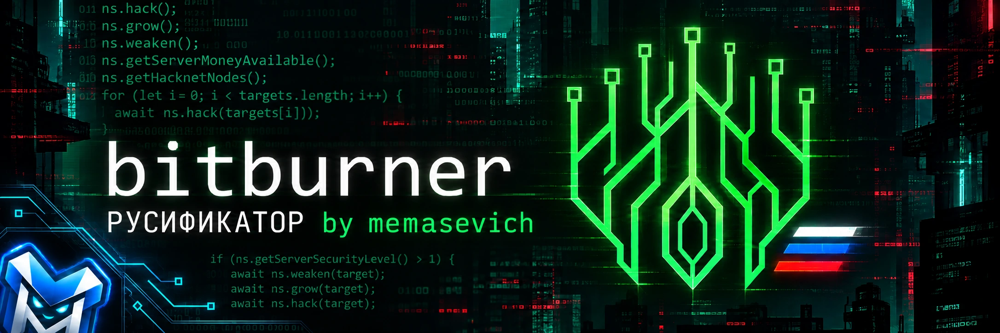
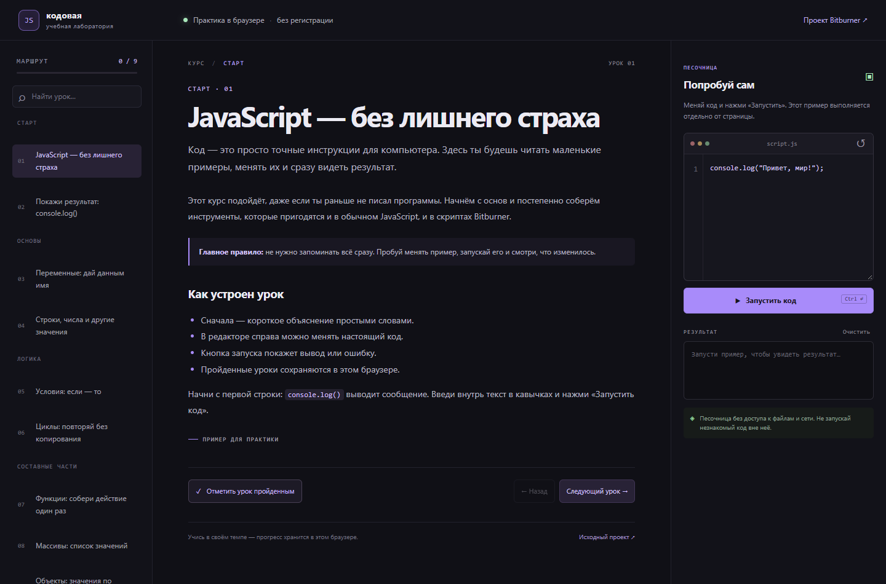
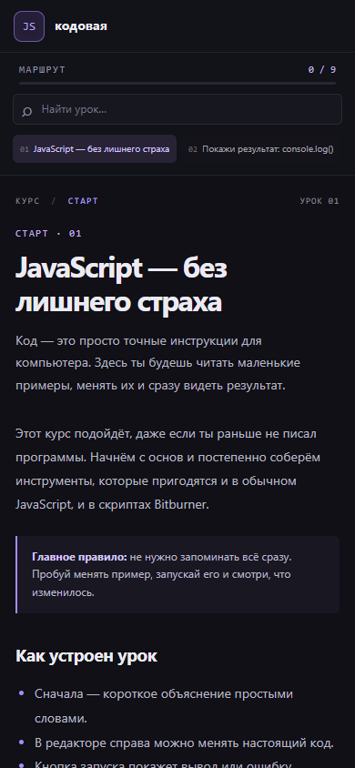
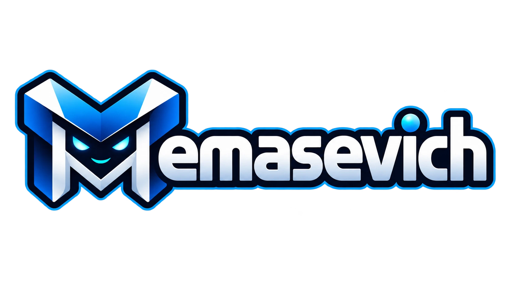

  

<h1 align="center">Bitburner по-русски</h1>

  Русификатор игры и бесплатный интерактивный курс JavaScript для начинающих.
   Версия игры: <b>Bitburner v3.0.1</b> · Русификатор: <b>0.2.3 — RU by memasevich</b>

  <a href="https://github.com/memasevich/Bitburner_ru/raw/refs/heads/main/downloads/Bitburner-RU-v0.2.3.zip"><b>⬇ Скачать только русификатор (.zip)</b></a>
  &nbsp; · &nbsp;
  <a href="https://github.com/memasevich/Bitburner_ru/tree/main/translation/resources/app"><b>📁 Где лежат файлы перевода</b></a>
  &nbsp; · &nbsp;
  <a href="https://memasevich.github.io/Bitburner_ru/learn-js-ru/"><b>🎓 Открыть курс JavaScript</b></a>

> **По первой ссылке скачивается отдельный архив только с русификатором.** Если нужен весь исходный проект (включая учебный сайт и материалы), [скачайте ZIP репозитория](https://github.com/memasevich/Bitburner_ru/archive/refs/heads/main.zip). В игру копируются только файлы русификатора.

## Как установить перевод

1. **Закройте Bitburner**, если игра запущена.
2. Нажмите [«Скачать только русификатор (.zip)»](https://github.com/memasevich/Bitburner_ru/raw/refs/heads/main/downloads/Bitburner-RU-v0.2.3.zip) и распакуйте архив.
3. Выделите всё содержимое распакованной папки — включая папку `dist`.
4. Откройте папку игры. Для Steam это обычно `Steam\steamapps\common\Bitburner\resources\app`.
5. **Скопируйте выбранные файлы и папку `dist`** в `resources\app` игры и согласитесь на замену файлов.
6. Запустите игру. В заголовке окна должна появиться отметка `Bitburner v3.0.1 (3162fd2) — RU by memasevich`.

Перед установкой рекомендуется сделать резервную копию папки игры. Архив по ссылке содержит только перевод; учебный сайт доступен отдельно и в папку игры не устанавливается.

## Учебный сайт: JavaScript с нуля

Вместе с переводом я сделал отдельный бесплатный курс для тех, кто только начинает знакомиться с программированием. Уроки можно проходить прямо в браузере: читать объяснения, менять примеры и запускать код в песочнице — без регистрации и установки.

  

<b>Так выглядит учебная лаборатория на компьютере и телефоне</b>

  
  &nbsp;
  

<a href="https://memasevich.github.io/Bitburner_ru/learn-js-ru/"><b>Перейти к курсу →</b></a>

## Что переведено

Русификатор охватывает игровые интерфейсы, основные подсказки и большую часть внутриигровой документации, в том числе:

- меню, навигацию и настройки;
- терминал и пояснения к его командам;
- персонажа, статистику и Hacknet;
- города, локации и путешествия;
- работу, компании, фракции и аугментации;
- корпорации, банды и клонов;
- фондовый рынок, Bladeburner и проникновения;
- обучение, справочные страницы и документацию API;
- достижения, вехи, сохранение и загрузку игры.

Перевод продолжается. Если заметите английский текст, который мешает игре, [сообщите об этом на GitHub](https://github.com/memasevich/Bitburner_ru/issues): укажите страницу, приложите скриншот и исходную английскую надпись.

## Что оставлено на английском и почему

Команды терминала, функции Netscript/API, имена серверов, названия файлов и программный код намеренно не переводятся. Иначе скрипты перестали бы совпадать с синтаксисом игры и примерами из документации. Например, `ns.hack()`, `ns.grow()` и `ns.weaken()` всегда остаются в исходном виде.

Названия городов и другие значения, которые нужно вводить в терминал или скрипт, также важно вводить так, как они заданы в игре. В некоторых местах рядом с оригинальным названием показан русский вариант, чтобы было понятно, что оно означает.

## Как удалить перевод

В Steam откройте **Библиотека → Bitburner → Свойства → Установленные файлы → Проверить целостность файлов игры**. Steam восстановит оригинальные файлы. Можно также вернуть резервную копию, если вы сделали её перед установкой.

## Об авторе и переводе

Я давно хотел сделать Bitburner доступнее для тех, кому интересны игра, программирование, логика и автоматизация, но кому английский мешает погрузиться в огромный объём интерфейса и документации. Не хочется, чтобы люди бросали игру не из-за её задач, а потому, что устали переводить каждую строчку.

Этот перевод я когда-то делал для себя и долго не думал о публикации. Теперь делюсь им с сообществом и постепенно улучшаю по отзывам игроков. Команды и код оставлены оригинальными, чтобы перевод помогал разобраться в игре и при этом не ломал скрипты.

- Автор: **memasevich** — [GitHub](https://github.com/memasevich)
- Telegram: [@memasev1ch](https://t.me/memasev1ch)
- Поддержать работу над проектом: [Boosty](https://boosty.to/memasevich)

Если проект оказался полезен — расскажите о нём другим игрокам или помогите найти оставшиеся непереведённые места. Спасибо!

История обновлений

### 0.2.3

- Исправлено зависание при переходе в путешествия и некоторые локации.
- Устранено повторное добавление перевода к одним и тем же надписям.
- Проверена стабильность ключевых экранов игры.

### 0.2.2

- Уменьшена нагрузка на интерфейс при частом обновлении текста.
- Улучшена отзывчивость игры во время работы и путешествий.

### 0.2.1

- Исправлено зависание при открытии карты города.
- Ускорена обработка перевода; ASCII-карта и её обозначения сохраняют исходный вид.

### 0.2.0

- Добавлена фоновая проверка обновлений русификатора.
- Для локаций сохранены оригинальные названия, рядом с ними показывается перевод.
- Расширен перевод интерфейсов, подсказок и игровых разделов.

---

  

